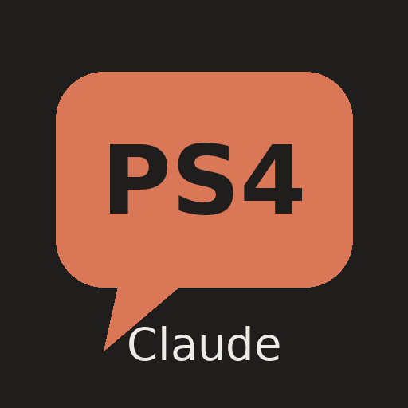

<!-- Copyright (C) 2026 Chokri Hammedi (blue0x1) <https://github.com/blue0x1>. All rights reserved. -->
# Claude for PS4

<p align="center">
  
</p>

> **Unofficial.** This is an unofficial Claude app for the PS4, made by Chokri Hammedi (blue0x1). It is not made, endorsed or supported by Anthropic or Sony Interactive Entertainment. Claude is a trademark of Anthropic; PlayStation and PS4 are trademarks of Sony Interactive Entertainment.

A native PS4 homebrew app (jailbroken console, GoldHEN) for chatting with Claude through the Anthropic API. Claude can also use console tools: it can read system info, browse and manage files, install and uninstall .pkg files, list and launch apps, set the fan threshold, look at your screenshots, and send payloads to GoldHEN BinLoader. Anything that writes, installs, deletes, launches or runs shows a confirm box first (on the TV, or on your phone if you use the phone remote). Nothing happens unless you allow it.

You can also chat from your phone: the PS4 serves a small web page on your home network.

Built with the OpenOrbis PS4 toolchain, SDL2 for the framebuffer, stb_truetype for text, the system HTTPS library (libSceHttp) with streamed replies, and the system on-screen keyboard (which also accepts a USB keyboard).

## Install

1. Install `IV0000-CLDE00001_00-CLAUDEFORPS40000.pkg` with GoldHEN (Debug Settings > Package Installer, or a remote pkg sender).
2. Start "Claude for PS4". The first time, it shows a QR code and a PIN.
3. Scan the code with your phone (same Wi-Fi), type the PIN, and pick how the PS4 reaches Claude (see below). Press Options any time to show the code again.

Settings are saved to `/data/claude/claude.ini`. You can also write that file yourself (see `claude.ini.example`) or put a `claude.ini` in the root of a USB drive. Your key is never built into the app.

## Two ways to sign in

| | API key | PC bridge (your Claude account) |
|---|---|---|
| What you need | An API key from console.anthropic.com | A PC on the same network with Claude Code signed in to your Claude account, running `tools/claude-bridge.py` |
| Billing | Pay per use on your API account | Uses your Claude plan's usage limits |
| PC must be on | No | Yes |
| Console tools (files, apps, pkg install, screenshots) | Yes | Yes (app 01.24 and the 01.24 bridge) |
| Install from PC, update check, PC dashboard | No | Yes (app 01.26 and the 01.26 bridge) |
| Model | Any API model (default claude-opus-5-5) | Whatever Claude Code uses, or `--model` on the bridge |

The PS4 cannot sign in to claude.ai directly: Anthropic does not let third-party apps use claude.ai account logins. The bridge stays within the rules by running the official Claude Code CLI on your own PC with your own login, and only passes text between it and the PS4.

### PC bridge setup

On the PC (Python 3 and Claude Code installed):

```sh
claude            # once: sign in with /login, then exit
python3 tools/claude-bridge.py            # add --model opus or sonnet if you like
```

It prints a bridge address (for example `http://192.168.1.50:8787`) and a pairing code. The quickest way to pair: open `http://127.0.0.1:8787` in a browser on the PC (the dashboard, which only opens on that PC), press Options on the PS4 and type the PIN from the TV into "Pair your PS4" ("Find my PS4" fills in its address). Or on the PS4 press Options, open the page on your phone, choose "PC bridge" and enter both.

The dashboard also shows the connected PS4, the packages waiting to be installed with their transfer progress, and the newest Claude for PS4 version on the PC. Options: `--pkg-dir` (folder of .pkg files to install from the PC, default `~/PS4/pkg`), `--app-pkg` (the Claude for PS4 pkg the PS4 compares its version with; by default the newest one next to the script), `--https` (encrypts the PS4's traffic with a self-signed certificate made by `openssl`; use an `https://` bridge address on the PS4. Packages then come from the next port over plain HTTP, because the PS4 installer cannot use a self-signed certificate). Allow port 8787 in the PC firewall if it has one. Claude Code's own tools are turned off in the bridge (`--tools ""`), so the PS4 cannot make it run commands on your PC. The PS4 console tools still work: the bridge offers them to Claude Code through a small local MCP server (the same script, `--mcp-child`), sends each call to the PS4 as a normal tool call, and passes the result back. The tools run on the PS4 with the same confirm boxes as in API key mode. A turn left waiting for a tool result for 20 minutes is ended. Each PS4 chat maps to one Claude Code session, kept in `~/.config/claude-ps4-bridge/`.

## What Claude can do for you

- **Undo deletes.** Deletes go to a trash first ("what did you delete?", "put it back", "empty the trash"). Every change is logged with who approved it ("what did you change today?").
- **Free up space.** "What is using my storage?" lists games with their updates and DLC, leftovers from removed games, installers you no longer need and big files, then cleans up what you pick with one confirm.
- **Back up saves.** "Back up all my saves to USB" or "restore my GTA saves from yesterday". Each backup is a new version (20 kept per game); a restore backs up the current saves first. Saves are tied to this console and user.
- **Install from your PC.** Put .pkg files in `~/PS4/pkg` on the PC and say "install the new games from my PC". Progress shows in the chat ("how far is it?") and a pop-up says when each is done.
- **GoldHEN.** "Which cheats are there for this game?", "turn on the 60 FPS plugin for Bloodborne", "turn on the FPS counter". Plugin and setting changes back up the ini file first.
- **Health.** "Is my PS4 running hot?" shows temperatures over time; "use the quiet fan" or "auto" picks a fan profile that comes back after a reboot.
- **Remember things.** "Remember that USB 0 is for backups." Claude uses it in every chat; "forget that" removes it.
- **Check for updates.** With the bridge, "is there an app update?" compares this version with the Claude for PS4 pkg on the PC. To update, copy the new pkg to `/data/pkg`, uninstall Claude for PS4 and install the new one (chats and settings in `/data/claude` stay); the PS4 installer does not install over an installed app.

### Permission modes

In the phone menu pick how much Claude may do: **Ask before every change** (default), **Trusted** (safe, undoable changes such as folders, copies, installs, backups, fan profiles and deletes that go to the trash run without asking; permanent deletes, uninstalls and payloads still ask), **Read-only** (look, never change) or **Kid mode** (read-only, a kid-friendly tone, no launching games). Claude can switch to a stricter mode itself but never to a looser one.

## Home screen folders

Ask Claude to sort your games, for example "make a folder called Racing with Need for Speed and GTA V". It can list, create, rename and remove home screen folders and move games in and out of them. Every change shows a confirm box, makes a backup of the home screen database in `/data/claude/backups` first (the newest 10 are kept) and checks the database afterwards. "Undo the last folder change" puts the newest backup back. The home screen reads folders when it starts, so restart the PS4 to see a change, and don't edit folders on the PS4 itself until then.

## Phone remote

The phone page keeps running while the app is open. Press Options to see the QR code and PIN, open the page and sign in with the PIN. Each PIN signs in one phone, and the phone stays signed in until the app restarts (up to 4 phones). From the phone you can:

- chat (the reply appears on the phone and on the TV)
- Allow or Deny a confirm box
- stop a reply, start a new chat
- change settings

Five wrong PINs make a new one appear on the TV and lock the sign-in for 30 seconds (doubling each time, up to 15 minutes). The page only answers devices on your home network (private addresses), so it stays closed to the internet even if a router port forward or DMZ points at the PS4. The bridge works the same way: home network only, and five wrong pairing codes block that address for a while.

The phone page uses plain HTTP on your home network, protected by the PIN. The bridge does too unless started with `--https`. Use them only on a network you trust.

The phone page has a microphone button next to Send. Phone browsers only allow the microphone on https pages, so on the PS4's page the button shows how to use the keyboard microphone instead (or, in Chrome on Android, how to allow this page in chrome://flags so the button itself listens), a "Help with my screen" button (take a screenshot with SHARE first; Claude looks at it) and quick actions on the start screen. The menu has the permission mode.

## Look and models

The app looks like the Claude desktop app: a sidebar, the chat in the middle, and a message box at the bottom. Claude's replies use a serif font and show Markdown (headings, bold, inline code, code blocks, lists, quotes). The phone page has the same look, in light or dark to match your phone.

Press R2 to pick the model and effort. Left/Right switches between the two lists, Cross picks, Circle closes. The choice is saved to `/data/claude/claude.ini` and used from the next message. The phone has the same two menus under the message box.

| Mode | Models |
|---|---|
| API key | Opus 5.5 (default), Sonnet 5.5, Haiku 5.5, Fable 5.2, Opus 5 |
| PC bridge | PC default, Opus, Sonnet, Haiku, Fable (latest of each in Claude Code) |

Effort is Default, Low, Medium, High, Extra high or Max. Higher effort thinks longer and costs more (or uses more of your plan in bridge mode). In bridge mode, effort needs a Claude Code version with the `--effort` option; the bridge tells you at start if yours lacks it.

## Controls

| Button | Action |
|---|---|
| Cross | Type a message (system keyboard, a USB keyboard works too) |
| Circle | Stop the reply that is streaming |
| Square | New chat |
| Triangle | Reload claude.ini |
| Options | Phone page (QR code and PIN) |
| R2 | Pick the model and effort |
| Up / Down, right stick | Scroll |
| L1 / R1 | Scroll one page |
| D-pad Left | Go to the sidebar: Up/Down picks a saved chat or Log out, Cross opens it, Circle goes back |
| Confirm box | Cross allows, Circle denies (or Allow/Deny on the phone) |

Each chat is saved to `/data/claude/chats/` as a readable `.txt` and a `.json` that lets you open it again from Recents and carry on. In bridge mode the chat continues in the same Claude Code session on your PC.

The bottom left shows who is signed in: your Claude account name in bridge mode (the bridge reads it from `claude auth status`), or your PS4 user name in API key mode. Log out asks first, then removes the API key and the bridge pairing from `/data/claude/claude.ini`. Chats and other settings stay, and every phone has to sign in again with a new PIN. On the phone page, the menu button at the top left has the same chat list, profile and Log out.

## Tools Claude can use

| Tool | Confirm on screen |
|---|---|
| get_system_info: firmware, CPU and SoC temperature, free space, IP | no |
| list_directory, read_text_file (up to 64 KB) | no |
| find_pkg_files on /mnt/usb0, /mnt/usb1, /data | no |
| list_installed_apps (title ID and name) | no |
| show_notification | no |
| list_screenshots, view_image (JPEG/PNG up to 3.5 MB, "latest" for the newest screenshot) | no |
| write_text_file, make_directory, copy_path, move_path, delete_path | yes |
| install_pkg (reads the pkg header, queues the install in Downloads) | yes |
| uninstall_app (save data stays) | yes |
| set_fan_threshold (45 to 80 C, resets on reboot) | yes |
| send_payload (.bin to GoldHEN BinLoader, port 9090) | yes |
| launch_app (closes this app) | yes |
| list_trash, show_history, storage_report, list_game_saves, list_save_backups, list_pc_packages, install_status, list_cheats, list_game_patches, list_plugins, goldhen_settings, health_report, temperature_history, get_preferences, check_app_update | no |
| restore_from_trash, empty_trash, delete_paths, restore_saves, install_from_pc, set_plugin, set_goldhen_setting, set_fan_profile | yes (some skip it in trusted mode) |
| backup_saves, remember, forget, set_permission_mode (stricter only) | no |

`/system`, `/system_ex`, `/preinst`, `/update`, `/dev` and the top-level folders themselves (`/data`, `/user`, `/mnt/usb0`) can never be written or deleted, even with a confirm.

At start the app asks GoldHEN to lift the app sandbox, so the tools can reach `/user`, `/system_data` and USB drives. The header shows "(sandboxed)" if that did not work; chat still works, but file tools see less.

## Build

Needs clang, ld.lld and OpenOrbis toolchain v0.5.2 (the newer release tarballs are named differently). `PkgTool.Core` needs libssl 1.1; on distros that only ship OpenSSL 3, extract `libssl1.1` from the Ubuntu 20.04 package and point `LD_LIBRARY_PATH` at it.

```sh
make OO_PS4_TOOLCHAIN=/path/to/PS4Toolchain
# host tests and UI preview PNGs
make -C tests OO_PS4_TOOLCHAIN=/path/to/PS4Toolchain
```

## Troubleshooting

- **"Could not reach api.anthropic.com (0x...)"**: check the network and the PS4 date and time (a wrong clock breaks HTTPS). If every request fails with a certificate error, the console's CA store may be missing the root used by api.anthropic.com. As a last resort set `tls_verify=0`, which turns off certificate checks for this app only and lets anyone on your network read the key.
- **API error 401**: the key in claude.ini is wrong or revoked. In bridge mode it means the pairing code does not match.
- **"Could not reach the PC bridge"**: check that claude-bridge.py is running, the address is right, and the PC firewall allows port 8787.
- **Bridge replies with a login error**: run `claude` on the PC and sign in with `/login`.
- **API error 400 mentioning fallbacks**: set `fallbacks=0` (some models do not accept it).

## Status

Version 01.26, tested on a real PS4 (CUH-7016B, firmware 14.00, GoldHEN) through the PC bridge. Tested on the console: chat, saved chats, install from PC with progress, save backup and restore, GoldHEN plugin and setting changes, health report, uptime and fan profiles, the update check, trash, all four permission modes, and the phone page (quick actions, screen help, mic help). pkg install, uninstall, fan control and payloads use the common homebrew system calls; tell us if one fails on your firmware.

Requests that fail before any reply text (no connection, rate limited, overloaded) are retried twice, after 2 and 4 seconds. At start the app warns if the clock looks wrong, since HTTPS needs the right date.

Known limits:
- The update check only tells you a new version is ready. Install it from the PS4 (Package Installer or install_from_pc). The app cannot replace itself.
- The phone mic needs HTTPS, or Chrome's "insecure origins treated as secure" flag. The phone keyboard's own mic works everywhere.

See CHANGELOG.md for what changed.

## Licenses

Claude for PS4 is an unofficial app by Chokri Hammedi (blue0x1), with no link to Anthropic or Sony. DejaVu Sans font: see `assets/fonts/DejaVu-LICENSE.txt`. stb_truetype: public domain / MIT. QR codes: Project Nayuki QR Code generator (MIT). GoldHEN jailbreak call based on the GoldHEN Plugins SDK (MIT).
